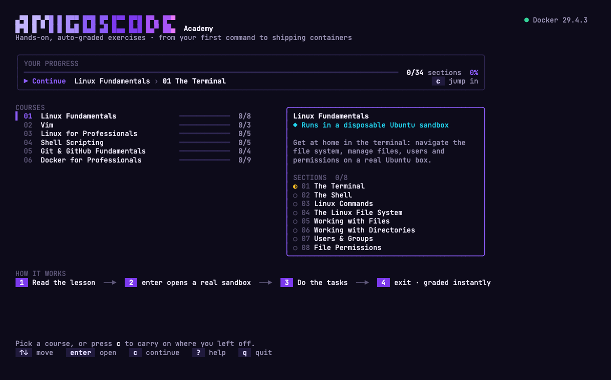
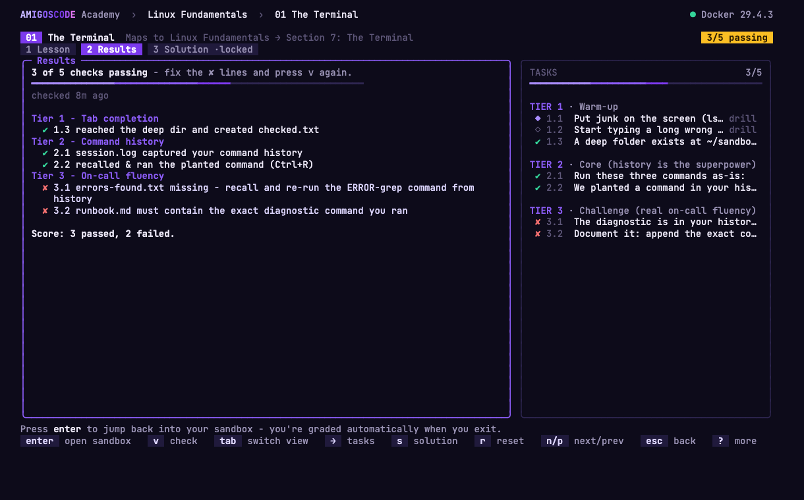

# Amigoscode DevOps Exercises

Hands-on, **auto-graded** exercises for the Amigoscode DevOps track. Every exercise
runs inside a disposable Ubuntu container, so destructive commands are safe, the
environment is identical for everyone, and a script checks your work with instant
✅ / ❌ feedback.

The goal: take you from Linux beginner to the practical, day-to-day skills a
**DevOps engineer** relies on.

## ▶ Start here: the Academy

Everything happens in **one terminal app**: browse the courses, read each lesson,
open a real sandbox with one key, and get graded the moment you leave it. Your
progress is tracked for you.

```bash
./academy.sh        # macOS, Linux, WSL, Git Bash, GitHub Codespaces
academy.cmd         # Windows (PowerShell or Command Prompt)
```

**Docker is the only thing you install.** The first run builds the app (about a
minute); after that it starts instantly.



### How it works

1. **Pick a section** - the dashboard shows every course, your progress, and a
   **Continue** shortcut (`c`) straight to where you left off.
2. **Read the lesson** - the exercise brief, rendered right in the terminal, with a
   task checklist beside it.
3. **Press `enter`** - you drop into a fresh, disposable sandbox with the scenario
   already set up. Break anything you like (even `rm -rf`) - it can't touch your machine.
4. **Type `exit` when you're done** - your work is graded instantly. Every task in
   the checklist turns ✔ or ✘, and each ✘ tells you exactly what is missing.



| Key | Does |
|-----|------|
| `enter` | open (a course, a section, your sandbox) |
| `v` | check your work again (also runs automatically when you exit the sandbox) |
| `tab` / `1`-`4` | switch Lesson · Results · Solution |
| `s` | show the solution - it asks you to try once more first |
| `r` / `x` | reset the scenario / remove the sandbox |
| `n` / `p` | next / previous section |
| `?` | all keys |

Progress is saved to [`my-journey/progress.json`](my-journey/) - commit it to your
fork with your notes and it becomes part of your portfolio.

> Prefer plain commands? Nothing changed underneath: every course still works with
> `make start / verify / reset` (courses 01-05) and `./course.sh` (Docker). They share
> the same containers as the Academy, so you can mix both. See
> [Without the Academy](#without-the-academy) below.

---

## 🚀 Getting started (your own copy + zero install)

You'll keep **your own copy** of these exercises, and still be able to pull in new
content whenever it's added.

### Step 1 - Fork it (your copy)

[**Fork this repository**](https://github.com/amigoscode/devops-exercises/fork) →
this creates `your-username/devops-exercises`, which is yours to keep.

### Step 2 - Open it in GitHub Codespaces (nothing to install)

On **your fork**: **Code → Codespaces → Create codespace on main**.

Wait ~1-2 min while it provisions Docker and pre-builds the Academy (handled by the
included [`.devcontainer`](.devcontainer/devcontainer.json)), then in the terminal:

```bash
./academy.sh
```

Prefer your own machine? Install [Docker](https://docs.docker.com/get-docker/), then:

```bash
git clone https://github.com/YOUR-USERNAME/devops-exercises.git
cd devops-exercises
./academy.sh          # Windows: academy.cmd
```

### Step 3 - Get new exercises later (one click)

When new courses or fixes are published, open your fork on GitHub and click
**Sync fork → Update branch**. Because your work lives in a git-ignored `~/sandbox`,
updates merge cleanly - you never lose progress. New sections appear in the Academy
automatically.

### 📓 Document your journey

The [`my-journey/`](my-journey/) folder is **yours** - log notes, commands and
takeaways as you go, then commit and push to your fork. Over time it becomes a
public **portfolio of your DevOps journey**. It's never touched by upstream syncs,
so it stays conflict-free.

---

## Courses

| # | Course | Status |
|---|--------|--------|
| 01 | [Linux Fundamentals](01-linux-fundamentals/) | ✅ 8 sections, fully tested |
| 02 | [Vim](02-vim/) | ✅ 3 sections, fully tested |
| 03 | [Linux for Professionals](03-linux-for-professionals/) | ✅ 5 sections, fully tested |
| 04 | [Shell Scripting](04-shell-scripting/) | ✅ 5 sections, fully tested |
| 05 | [Git & GitHub Fundamentals](05-git-github-fundamentals/) | ✅ 4 sections, fully tested |
| 06 | [Docker for Professionals](06-docker/) | ✅ 6 sections + 3 capstones (full-stack, microservices, real-app review), fully tested |

More courses in the DevOps track (Git for Professionals, CI/CD, AWS) will be added
with the same format.

## How the exercises work

- **A disposable sandbox per section** - a fresh Ubuntu container with the scenario
  set up in `~/sandbox`. The **Docker** course is the exception: Docker itself is the
  subject, so you run `docker` against your own daemon and the grader inspects the
  real containers, images and volumes you created.
- **Three tiers per section**: warm-up → core → a real DevOps challenge.
- **Auto-graded**: each section ships a `verify.sh` that scores your work.
- **Solutions included**: stuck? every section has a `solutions.md` - but try first.

## Without the Academy

The Academy is a front end over plain scripts, so you can always drive them directly.

**Courses 01-05** need **Docker** + **make**. `make` is a tiny command runner: `make
start S=01-the-terminal` just means *"use Docker to spin up the Ubuntu sandbox for
this exercise and drop me into it."*

```bash
cd 01-linux-fundamentals
make build                       # once
make start S=01-the-terminal     # enter a pristine Ubuntu shell, scenario seeded
#   ...work in the container; when done, type 'exit' (or Ctrl+D) to leave, then:
make verify S=01-the-terminal    # grade your work
make reset S=01-the-terminal     # fresh start
```

**Docker for Professionals** ships its own launcher (no `make`):

```bash
./course.sh verify 01-containers     # macOS/Linux/WSL
course.cmd  verify 01-containers     # Windows
./course.sh install                  # once: a `course` command that works anywhere
```

Its [README](06-docker/) explains the rest.

## Repository layout

```
devops-exercises/
├── academy.sh / academy.cmd  # ▶ start here: the terminal app for every course
├── academy/                  # the Academy's source (Go + Charm), built in Docker
├── .devcontainer/            # Codespaces config (Docker-in-Docker + make)
├── my-journey/               # your notes & progress.json (commit to your fork)
├── 01-linux-fundamentals/    # a course (one folder per course)
│   ├── Dockerfile            # the shared Ubuntu exercise image
│   ├── Makefile              # make build / start / verify / reset / stop
│   └── NN-topic/             # each section: README, seed.sh, verify.sh, solutions.md
├── 02-vim/
├── ...
└── 06-docker/                # host-Docker course: runner.sh + course.sh launchers
```

Adding a course or section is just adding a folder in this shape - the Academy
discovers it on the next launch.
